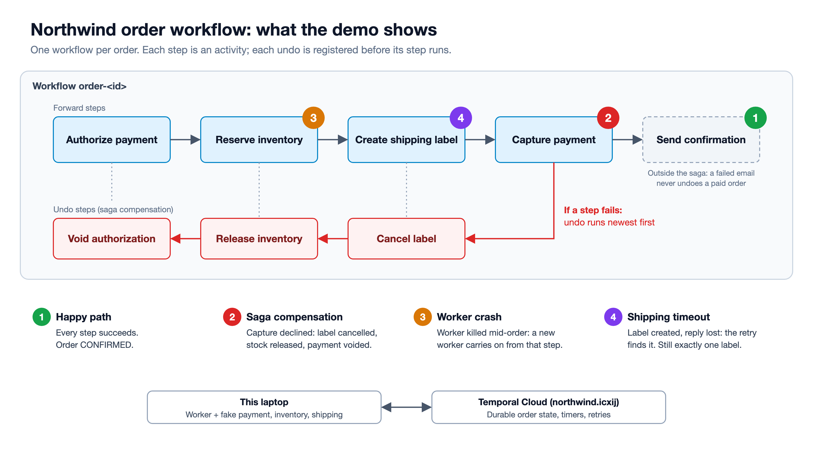

# Northwind order processing on Temporal

A thin demo of one workflow: submit order, authorize payment, reserve inventory, create shipment, capture payment, send confirmation. It runs on Temporal Cloud against fake downstream services and shows the happy path, duplicate-order rejection, saga compensation, a worker crash, and a shipping timeout retried without a second label.

## Layout

```
build.gradle, Dockerfile, docker-compose.yml, scripts/demo.sh
src/main/java/com/northwind/orders/
  Shared.java                task queue, data types, error types
  OrderWorkflow.java         workflow interface and status query
  OrderWorkflowImpl.java     saga, timeouts, search attributes
  OrderActivities.java       activity interface
  OrderActivitiesImpl.java   HTTP calls to the fakes; shipping looks up by reference before creating;
                             prints one line per step and per failure for the worker pane
  TemporalClients.java       Temporal Cloud connection from .env (address, namespace, API key)
  WorkerMain.java            worker entry point (identity worker-xxxx, new per start)
  StarterMain.java           CLI: start / submit / status / result; starts with ID reuse policy REJECT_DUPLICATE
src/main/java/com/northwind/fakes/
  FakeServices.java          fake payment, inventory, shipping, notify (one process, :8080); magic values below
src/test/java/com/northwind/orders/
  OrderWorkflowTest.java         happy path
  OrderFlowsTest.java            out of stock voids payment; shipment failure undoes everything;
                                 declined capture undoes all three steps, newest first
  OrderShippingTimeoutTest.java  label created then timeout: retry finds it, one label
  OrderReplayTest.java           replays recorded Cloud histories (happy, shipping, crash) against current code
src/test/resources/histories/    the recorded histories (`temporal workflow show -w order-<id> -o json`)
docs/demo-flow.png               the diagram below
```

Fake-service magic values: customer `declined` (card declined at authorization), sku `SKU-OUT` (out of stock), customer `capture-fails` (capture declined after the label exists), customer `slow-shipping` (label created, then the reply stalls 12s), sku `SKU-SLOW` (inventory stalls 8s on the first attempt). `GET /order?id=<id>` shows one order's payment, inventory and label state.

## Setup (once)

Requirements: Docker Desktop, and a Temporal Cloud namespace with an API key.

### 1. Temporal Cloud connection (`.env`)

The worker and the starter connect to Temporal Cloud using three environment variables. Put them in `.env` in this folder:

```bash
cp .env.example .env
```

| Variable | Value | Where to find it in the Cloud UI |
|---|---|---|
| `TEMPORAL_ADDRESS` | `<namespace>.<account>.tmprl.cloud:7233` | Namespaces, your namespace: the gRPC endpoint |
| `TEMPORAL_NAMESPACE` | `<namespace>.<account>` | Namespaces: the full namespace name |
| `TEMPORAL_API_KEY` | the API key | Settings, API Keys: create a key with access to the namespace (shown once; copy it then) |

How they are used:
- `docker compose` reads `.env` automatically and passes the three variables to the worker and starter containers. `.env` is gitignored and excluded from the Docker image (`.dockerignore`), so the key never lands in git or in the image.
- `TemporalClients.java` reads them at start-up and connects over TLS with the API key. Nothing is hard-coded; if one is missing, the worker or starter stops with `TEMPORAL_... is not set`.
- The same variables work for the `temporal` CLI, which is handy for checking the namespace from a terminal:

  ```bash
  set -a; . ./.env; set +a; export TEMPORAL_TLS=true
  temporal workflow list --limit 5
  ```

Never put the key on a command line or in a file other than `.env`.

### 2. Search attributes

In the Cloud UI, add two custom search attributes to the namespace, both type Keyword: `OrderStatus` and `CustomerId`. Without them the workflow fails on its first status update.

## Screen layout

Two terminals side by side or stacked, plus the Cloud UI. Both terminals in this folder.

| Pane | Runs | Shows |
|---|---|---|
| Worker terminal | `./scripts/demo.sh worker` | The worker, in the foreground. New name (`worker-xxxx`) on every start, one line per step: `<order-id>  ReserveInventory  attempt 1`. |
| Command terminal | the step commands below | Order results and downstream state. |
| Browser | Temporal Cloud UI, Workflows | The workflow for each order. |

## Before you start

1. Start Docker Desktop.
2. Command terminal: `./scripts/demo.sh up` (builds the image, starts the fake services, prints the Cloud UI link).
3. Command terminal: `./scripts/demo.sh reset` (clears the fake services' state from earlier runs).
4. Worker terminal: `./scripts/demo.sh worker`. Wait for `[worker-xxxx] started, polling task queue 'orders'`.
5. Sign in to the Temporal Cloud UI and open Workflows.

## Order IDs

Every step command takes an order ID as its last argument, for example `./scripts/demo.sh happy 1001`. Use a new ID for each step (1001, 1002, ...). If you leave it off, the script uses the time of day (`HHMMSS`).

An order ID can only be used once. The starter sets the Workflow ID Reuse Policy to `REJECT_DUPLICATE`, so Temporal rejects a second `order-<id>` whether the first run is still going or finished, for the namespace's retention period. `reset` does not change this. Step 1b relies on it.

## Run of show



The numbers on the diagram match the steps below. In the table, `<id>` is a new order ID for each step.

| # | Command | Description | Recommended steps |
|---|---|---|---|
| 1 | `./scripts/demo.sh happy <id>` | Happy path: every step succeeds and the order is confirmed. | Command terminal: run it; the result is `CONFIRMED`. Worker terminal: one line per step as the worker runs it. UI: explore the Workflows list, then click into `order-<id>` to view the Timeline and Event History. |
| 1b | `./scripts/demo.sh happy <id>` again, same ID | Duplicate submit is rejected (Workflow ID Reuse Policy `REJECT_DUPLICATE`). | Command terminal: rerun step 1 with the same ID; it prints `rejected: order-<id> was already submitted`. Worker terminal: nothing runs. UI: still one run of `order-<id>`. |
| 2 | `./scripts/demo.sh saga <id>` | Saga compensation: the payment capture is declined at the end, so the label, the stock and the payment are undone, newest first. | Command terminal: the result is `REJECTED (PaymentDeclined)`, then the order's downstream state: payment authorized then voided, inventory not reserved, label CANCELLED. Worker terminal: `CapturePayment ... FAILED (PaymentDeclined, not retried)`, then `CancelShipment`, `ReleaseInventory`, `VoidAuthorization`. UI: explore the Workflows list, then click into `order-<id>` to view the Timeline and Event History. |
| 3 | `./scripts/demo.sh crash <id>` | Worker crash: the worker is killed mid-order and a new worker carries on from the step it was on. | Command terminal: run it; it submits the order and kills the worker about 2s later, while inventory is stalling. Worker terminal: shows `ReserveInventory attempt 1`, then the kill; press ↑ Enter to start a new worker, which picks up at `ReserveInventory attempt 2` and finishes. UI: before restarting, open `order-<id>`: still Running, ReserveInventory pending. After restarting, view the Timeline and Event History: the old worker name before the kill, the new one after. Command terminal: `./scripts/demo.sh result <id>` prints `CONFIRMED`. |
| 4 | `./scripts/demo.sh shipping <id>` | Ambiguous timeout: the shipping provider creates the label but replies too late; the retry finds the label instead of buying a second one. | Command terminal: the result is `CONFIRMED`, then exactly one label for the order. Worker terminal: `CreateShipment attempt 1`, then `attempt 2`; about 12s later, the provider's late reply to attempt 1, discarded by Temporal. UI: explore the Workflows list, then click into `order-<id>` to view the Timeline and Event History. |

Also worth showing: filter the Workflows list by `OrderStatus` or `CustomerId`.

When you're done: `./scripts/demo.sh down`.

## Notes

- **Do not use the Workers page as proof** in step 3: a killed worker stays RUNNING there for about 5 minutes (until its heartbeat expires), then drops off the list. Use the worker names in the Event History.
- **Other commands:** `kill` (kill the worker), `status <id>` (live query, needs a worker), `result <id>` (wait for an order's result), `state` (fake-service counters), `reject <id>` (card declined at authorization, nothing to undo), `stock <id>` (out of stock: inventory released, payment voided).
